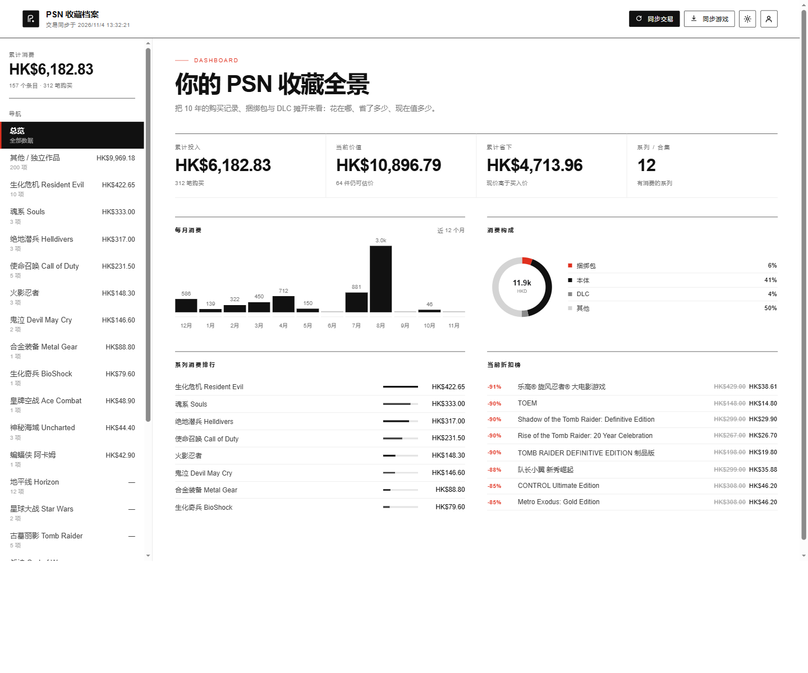
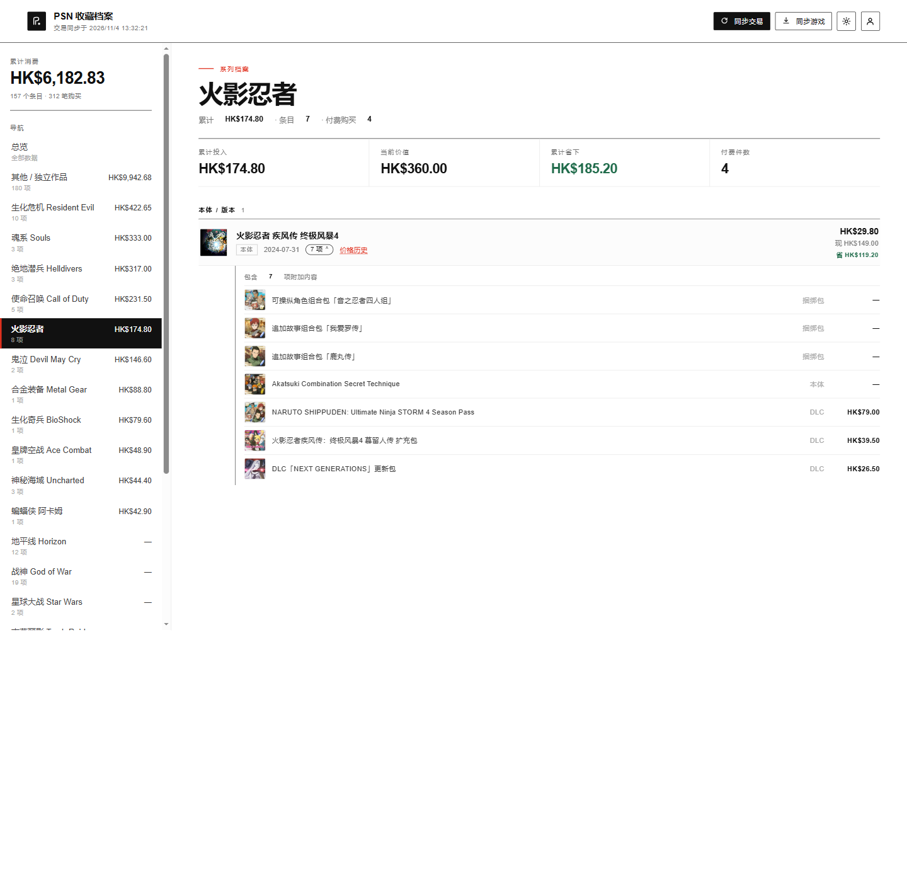
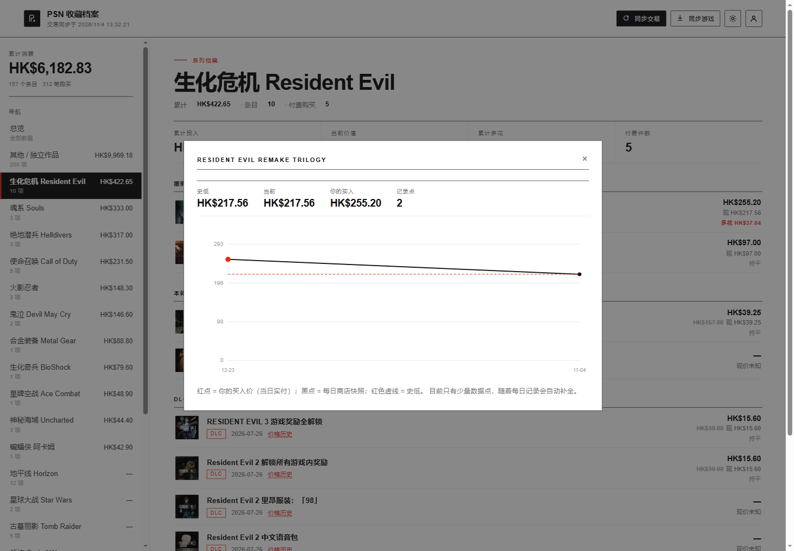
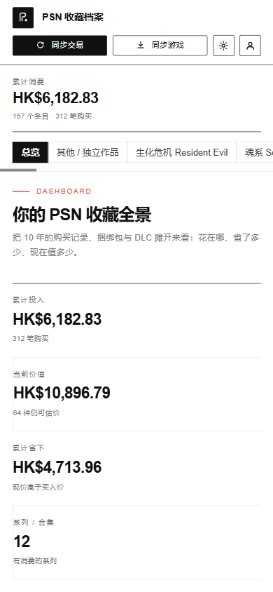

# PSN 收藏档案

**把你十年在 PlayStation 上花的钱，摊开来看。**

一个本地优先（local-first）的 PSN 消费分析工具。读取你自己的 PSN 账号数据，整理成「系列 → 捆绑包 / 本体 / DLC」的档案，对齐商店当前价格，告诉你到底省了多少、买贵了哪几笔。

> ⚠️ 本项目调用索尼**未公开接口**，可能违反服务条款，存在账号受限风险。请自行评估后使用。
> 🔒 所有令牌、Cookie、购买记录**只保存在你自己电脑上**，不上传任何服务器。代码里没有任何遥测。



---

## 目录

- [功能](#功能)
- [截图](#截图)
- [快速开始](#快速开始)
- [使用指南](docs/USAGE.md) · [技术说明](docs/ARCHITECTURE.md)
- [工作原理](#工作原理)
- [数据安全](#数据安全)
- [部署](#部署)
- [常见问题](#常见问题)
- [已知限制](#已知限制)
- [路线图](#路线图)

---

## 功能

### 📊 消费总览
- **累计投入**：从官方交易记录汇总，精确到分
- **当前价值**：按商店现价重算你手上的收藏值多少钱
- **累计省下**：现价高于买入价的差额
- **月度柱状图**、**构成环形图**（捆绑包 / 本体 / DLC / 其他）、**系列排行**、**当前折扣榜**

### 🗂 系列档案
点开「生化危机」，就能看到这个系列累计花了多少、哪些是本体、哪些是 DLC、哪些是捆绑包。

### 🌲 树形下钻
一个游戏只占一行。捆绑包、季票、DLC 全部收在展开层，**不会重复出现**。



### 💰 价格历史
每款商品都有「价格历史」入口，记录每日商店快照，画出你买入以来的价格曲线，标出**史低**和**你的买入价**。



### 🏷 来源标记
区分**真金白银购买**、**PS Plus 会员领取**、**免费领取**、**随包附赠**。再也不会上“我什么时候买过这个”的当。

### 📦 捆绑包分析
包内含哪几款游戏、当前包价 vs 单买合计、买包省多少、每个子项的分摊成本。

### 📱 PWA
支持添加到 iPhone / Android 主屏幕，全屏运行。

---

## 截图

| 总览 | 系列档案 |
|---|---|
|  |  |

| 价格历史 | 移动端 |
|---|---|
|  |  |

---

## 快速开始

### 环境要求

- **Node.js 20+**（推荐 22 / 24）
- 现代浏览器（Chrome / Edge / Safari 16+）

### 三步启动

```bash
git clone <你的仓库地址> psn-archive
cd psn-archive
npm start
```

然后打开 <http://localhost:8787>。

Windows 用户也可以双击 `start.ps1`。

> 详细图文步骤见 **[使用指南](docs/USAGE.md)**（登录、Cookie 捕获、界面说明、排错表）。

---

## 工作原理

数据来自三个地方，全部是**只读**的官方接口：

| 数据 | 接口 | 用途 |
|---|---|---|
| 账号令牌 | `ca.account.sony.com/api/authz/v3/oauth` | OAuth 换取 access token |
| 游戏库 | GraphQL `getPurchasedGameList` | 你拥有的游戏 + 封面 |
| 交易记录 | GraphQL `transactionHistoryRetrieve` | 每笔订单的商品、金额、日期 |
| 商店现价 | GraphQL `productRetrieveForCtasWithPrice` | 当前原价 / 折后价 |
| 游戏来源 | `gamelist/v2/users/me/titles` | 自有 / PS Plus 领取 / 其他 |

**商品归组规则**：商品 ID 的前两段（如 `HP0700-CUSA02957_00`）是游戏命名空间，同一命名空间下的本体、DLC、季票、组合包会被归入同一个游戏。

---

## 数据安全

这是本项目最重要的一节。

### 存在哪里

| 文件 | 内容 | 敏感度 |
|---|---|---|
| `server/data.json` | 令牌、Cookie、游戏库、全部交易记录 | 🔴 **极高** |
| `server/price-history.json` | 每日价格快照 | 🟢 低 |
| `import/` | 调试中间数据、截图 | 🟡 可能含账号信息 |

前两项永远**只在本地**。代码里没有任何上报逻辑。

### 上传 GitHub 前

`.gitignore` 已默认排除：

```gitignore
server/data.json
server/price-history.json
import/
```

提交前请务必确认：

```bash
git status --ignored
```

看不到 `data.json` 才安全。

### 不要做什么

- ❌ 不要把 `data.json` 发给任何人（里面有可直接登录你账号的 `npsso`）
- ❌ 不要开一个多人共用的公共实例（等于把大家的凭证放在一个文件里）
- ❌ 不要把带 `npsso` 的截图发到社交媒体

### 一键登出

应用右上角头像 → 「登出并清除凭证」，会删除本地保存的令牌与 Cookie。

---

## 部署

本项目**不提供公共托管**。理由很简单：凭证不能集中存管。推荐每人部署到自己的账号下。

### Render（免费，最简单）

1. Fork 本仓库
2. Render → New → Blueprint，选中 fork 的仓库（已带 `render.yaml`）
3. 部署完成后打开分配的域名

### Railway

新建项目 → Deploy from GitHub → 自动识别 `railway.json`。

### Docker

```bash
docker build -t psn-archive .
docker run -p 8787:8080 -v $(pwd)/data:/app/server psn-archive
```

### ⚠️ 部署注意

| 事项 | 说明 |
|---|---|
| **磁盘是临时的** | Render / Railway 免费实例重新部署会清空 `data.json`，建议定期用「导出 JSON」备份 |
| **凭证存在实例里** | `npsso`、Cookie 会写进该实例的 `data.json`，只部署到**你自己的**账号下 |
| **IP 风控** | 同一 IP 高频调用索尼接口可能被限流，个人使用量无压力 |

---

## 常见问题

<details>
<summary><b>交易记录同步失败，提示权限不足？</b></summary>

交易接口需要**网页会话 Cookie**（`npsso` + `pdccws_p`），光有 OAuth 令牌不够。

1. 关闭所有浏览器窗口
2. 用调试端口启动：`msedge.exe --remote-debugging-port=9222`
3. 在打开的浏览器里登录 `store.playstation.com`
4. 运行 `node tools/capture-cookies.mjs`
5. 回到应用点「同步交易」

Cookie 有效期约 30 天。
</details>

<details>
<summary><b>为什么有些游戏显示「现价未知」？</b></summary>

常见于：已下架商品、试玩版、免费领取的头像/主题、以及部分区域限定商品。商店对这些没有货架条目。

这类条目会被收进「其他」折叠区，不干扰主列表。
</details>

<details>
<summary><b>「会员领取」是怎么判断的？</b></summary>

调索尼的游戏列表接口，每条记录带 `service` 字段：

- `none(purchased)` → 自有
- `ps_plus` → PS Plus 会员领取
- `other` → 其他来源

匹配不上的（DLC、头像不在游戏列表里）显示为空。
</details>

<details>
<summary><b>季票到底包含哪些 DLC？</b></summary>

**商店不公开这个信息。** 本项目只做「同一游戏命名空间」的归组，不会声称「季票包含 X」。

对于有明确交易时间证据的（买入大包后若干秒自动到账 0 元小包），会标记「随包附赠」。
</details>

<details>
<summary><b>价格历史为什么只有几个点？</b></summary>

价格历史从你第一次运行本项目那天开始积累，每天自动快照一次。历史购买记录会作为锚点补进去（你的实付价就是当天的折后价）。

跑得越久，曲线越完整。
</details>

---

## 已知限制

- **价格历史需要时间积累**，无法回溯索尼未公开的历史价格
- **季票覆盖范围不透明**，只做命名空间归组，不做断言
- **系列归类**依赖关键词 + 命名空间，长尾游戏仍可能落到「其他」
- **捆绑包子项单价**覆盖不完整（商店只给包价）
- **仅测试了港服（HK）**，其他区域理论可用但未验证

---

## 路线图

- [ ] 降价提醒（收藏未购游戏跌破史低时通知）
- [ ] 游玩时长 × 花费的性价比排行
- [ ] 支持更多区域（日服 / 美服 / 欧服）
- [ ] 导入 PSN 官方 CSV 作为备用数据源
- [ ] 数据导出为 Markdown / CSV 年报

---

## 贡献

欢迎 Issue 和 PR。特别需要：

- 各区域的商品 ID 命名空间样本
- 系列关键词映射表的补充
- 更可靠的 DLC 包含关系推断

---

## License

[MIT](LICENSE)

---

## 免责声明

本项目与 Sony Interactive Entertainment 无任何关联。所有接口均为未公开接口，随时可能变更或失效。

**使用风险自负。** 因使用本项目导致的账号受限、数据丢失等后果，作者不承担责任。
